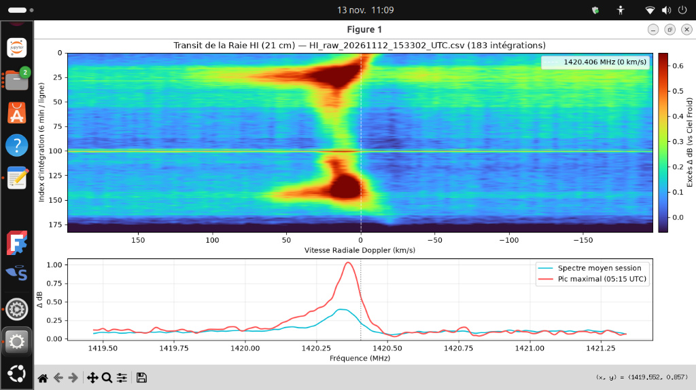
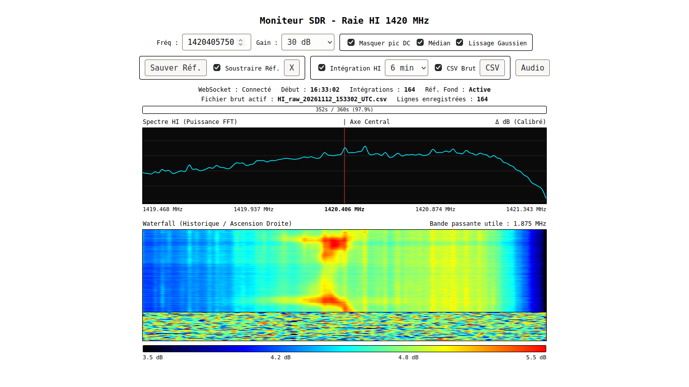
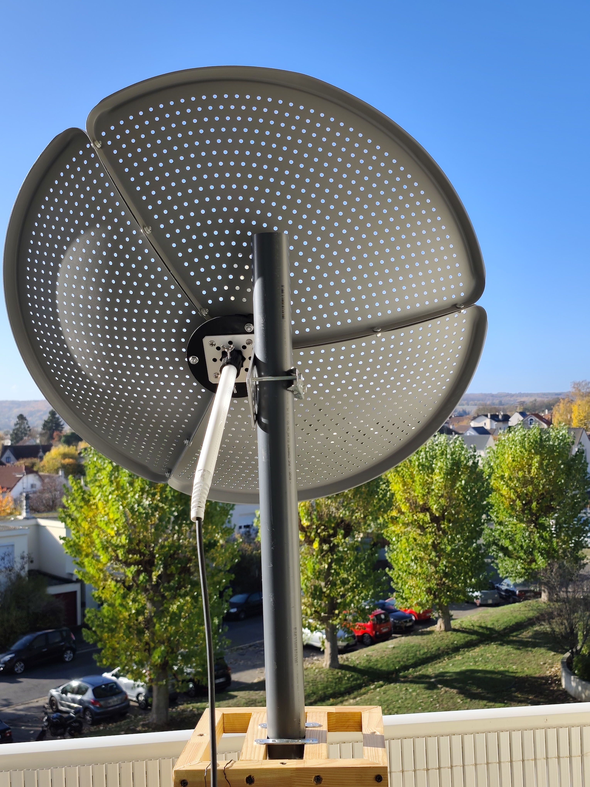
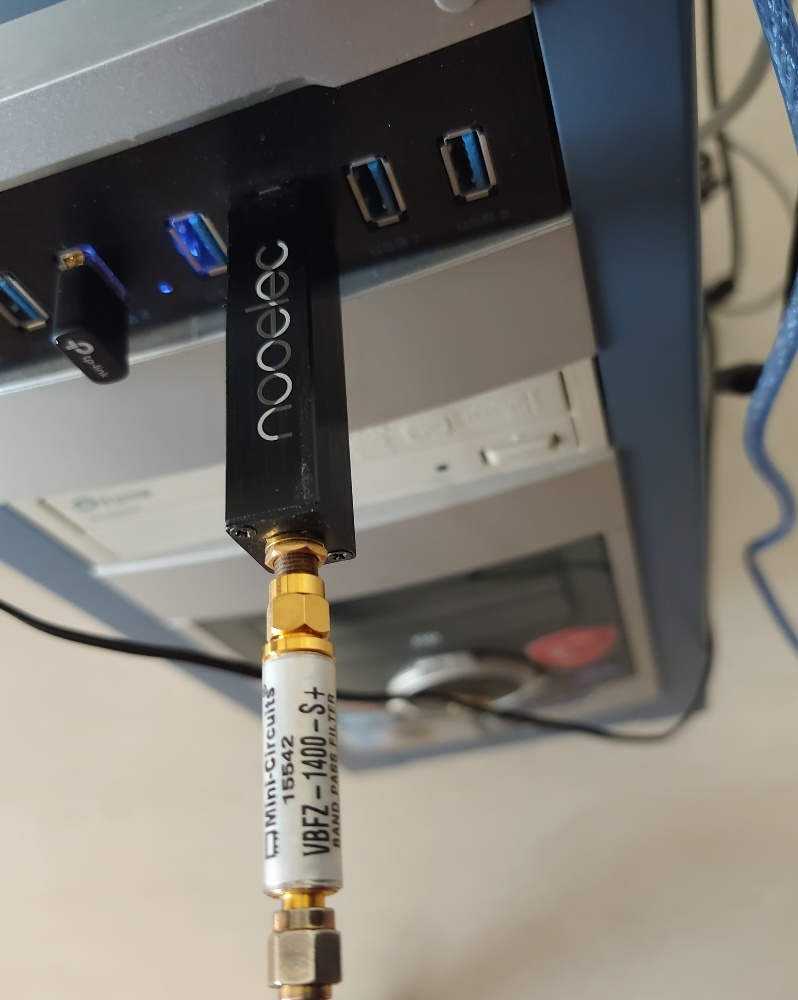
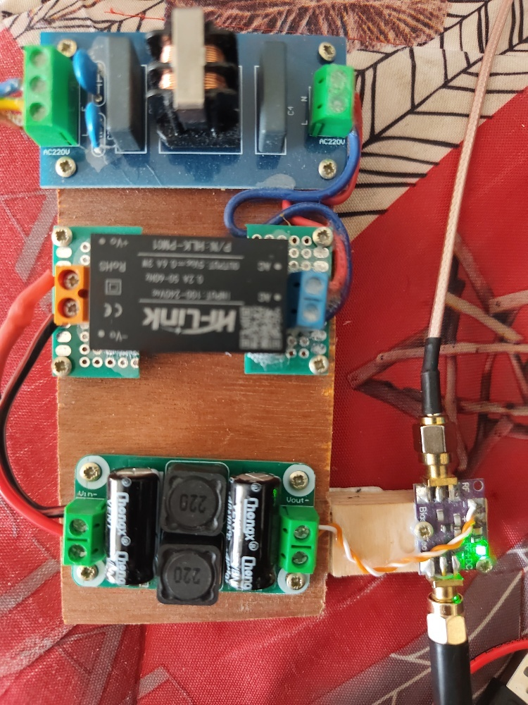

# Moniteur Web SDR — Raie d'Hydrogène Neutre HI (1420.406 MHz)

Station logicielle légère en **Python / FastAPI** et **HTML5 Canvas / WebSocket** conçue pour l'observation radioastronomique continue de la raie à 21 cm de l'hydrogène neutre galactique (`1420.40575 MHz`) à l'aide d'un récepteur **RTL-SDR**.



## Résultats scientifiques observés

L'analyse post-traitement (`analyze_transit.py`) sur une session continue de **183 intégrations** (> 18 heures d'acquisition) met en évidence :
- **La double traversée du plan galactique :** Deux passages nets des bras spiraux de la Voie lactée dans le faisceau fixe de la parabole au fil de la rotation terrestre.
- **La cinématique Doppler de la galaxie :** Un étalement spectral vers les vitesses radiales positives (`+10` à `+100 km/s` par rapport à l'axe au repos `1420.406 MHz`), révélant la rotation différentielle des bras spiraux externes.
- **Un rapport signal/bruit de +1,00 dB :** Pic d'émission relevé à `05:15 UTC` au-dessus d'une ligne de base calibrée sur ciel froid parfaitement plate.



## Fonctionnalités principales

- **Décalage matériel (LO Offset) & suppression dynamique du pic DC :** Accord décalé de `-250 kHz` suivi d'une transposition numérique complexe en bande de base et d'une interpolation dynamique de l'artefact DC matériel, éliminant tout pic central parasite.
- **Intégration longue durée (Radiomètre numérique) :** Accumulation cohérente de puissance FFT sur `1 min`, `3 min` ou `6 min` pour extraire le faible signal galactique du bruit thermique.
- **Calibration par soustraction de référence :** Capture d'un spectre de référence (sur charge fictive 50 Ω ou sur région calme du ciel froid) pour aplatir la courbe de réponse du filtre passe-bande.
- **Traitements visuels 100 % réversibles côté client :** Bascule instantanée sur l'historique en mémoire entre le signal brut, le filtre médian anti-impulsions et le lissage gaussien sans interrompre l'acquisition.
- **Archivage scientifique brut horodaté UTC :** Sauvegarde automatique de chaque spectre intégré brut (non lissé) dans `observations/HI_raw_YYYYMMDD_HHMMSS_UTC.csv` avec métadonnées instrumentales complètes et téléchargement direct depuis l'interface web.
- **Contrôle strict du gain manuel :** Désactivation complète du CAG (Contrôle Automatique de Gain) afin de garantir une ligne de base stable sur plus de 18 heures d'observation continue.

## Chaîne matérielle complète

| Antenne (Parabole Prime-Focus) | Récepteur & Filtrage RF | Alimentation Fantôme (Bias-Tee) |
| :---: | :---: | :---: |
|  |  |  |

1. **Antenne :** Parabole *prime-focus* ajourée (70 cm, 3 pétales, bande L) dédiée à la raie HI 1420 MHz avec illuminateur axial et LNA intégré.
2. **Alimentation fantôme (Bias-Tee) :** Module secteur 5 V **Hi-Link HLK-PM01** précédé d'un filtre secteur EMI et suivi d'un double filtre LC en Pi ( 2 × 22 µH + condensateurs de découplage) alimentant le Bias-Tee pour une observation continue 24h/24 (ou batterie 5 V pour un plancher thermique minimal).
3. **Filtrage passe-bande :** Filtre coaxial **Mini-Circuits VBFZ-1400-S+** (1280–1550 MHz) vissé directement en entrée du récepteur pour rejeter les signaux hors-bande (4G/5G, Wi-Fi).
4. **Récepteur SDR :** **Nooelec NESDR SMArt** (TCXO 0,5 PPM, boîtier aluminium) piloté en mode IQ brut via `rtl_sdr` (gain manuel fixe à 30 dB, CAG désactivé).

> **Note importante sur la calibration 50 Ω :** Si vous utilisez une charge fictive 50 Ω pour enregistrer une référence, ne la vissez jamais directement sur la sortie RF+DC d'un Bias-Tee sous tension sans intercaler un condensateur de blocage continu (*DC Block*), au risque de surchauffer la résistance.

## Installation et démarrage

### 1. Prérequis système (Debian / Ubuntu)

```bash

sudo apt update && sudo apt upgrade -y
sudo apt install -y git rtl-sdr librtlsdr-dev wget
echo 'blacklist dvb_usb_rtl28xxu' | sudo tee /etc/modprobe.d/blacklist-rtl.conf
sudo modprobe -r dvb_usb_rtl28xxu 2>/dev/null || true

```

### 2. Installation, Création et activation de l'environnement Conda (Miniconda3)

```bash
mkdir -p ~/miniconda3
wget https://repo.anaconda.com/miniconda/Miniconda3-latest-Linux-x86_64.sh
bash ~/miniconda3/miniconda.sh -b -u -p ~/miniconda3
rm ~/miniconda3/miniconda.sh
~/miniconda3/bin/conda init bash
source ~/.bashrc
conda tos accept --override-channels --channel https://repo.anaconda.com/pkgs/main
conda tos accept --override-channels --channel https://repo.anaconda.com/pkgs/r
git clone https://github.com/TVIEIL/RTL-SDR-hi-web.git
cd RTL-SDR-hi-web
conda create -n RTL-SDR-hi-web python=3.11 -y
conda activate RTL-SDR-hi-web
pip install -r requirements.txt
```

### 3. Lancement du moniteur

```bash
killall -9 rtl_sdr 2>/dev/null
python3 -m uvicorn server:app --host 0.0.0.0 --port 8080
```

Ouvrez ensuite votre navigateur à l'adresse http://127.0.0.1:8080.
